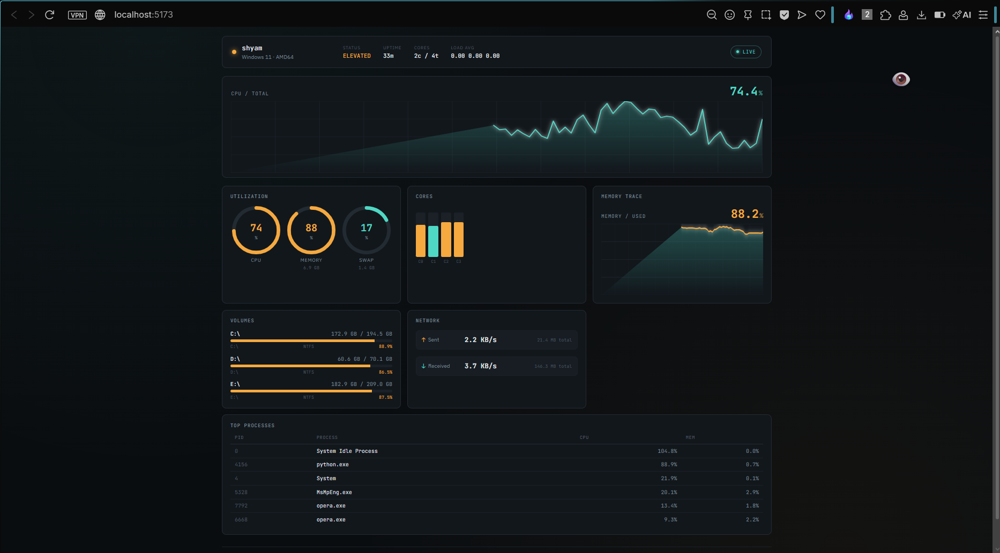

# Server Health Console

A real-time server health dashboard. FastAPI + `psutil` on the backend, streaming
live host metrics over a WebSocket to a React + TypeScript frontend styled as an
instrumentation console (live oscilloscope-style CPU trace, per-core bars, disk
and network panels, top-process table).

## Output



```
server-health-dashboard/
├── backend/          FastAPI app (psutil metrics, REST + WebSocket)
│   ├── main.py
│   └── requirements.txt
└── frontend/         React + TypeScript (Vite)
    ├── src/
    └── package.json
```

## Run it

**Backend** (from `backend/`):

```bash
python3 -m venv .venv && source .venv/bin/activate   # optional but recommended
pip install -r requirements.txt
uvicorn main:app --reload --port 8000
```

**Frontend** (from `frontend/`, in a second terminal):

```bash
npm install
npm run dev
```

Open the URL Vite prints (usually `http://localhost:5173`). The dev server proxies
`/api` and `/ws` to `http://127.0.0.1:8000`, so both sides talk to each other
automatically — no CORS config needed in dev.

## What it shows

- **Status bar** — hostname, OS, uptime, core/thread count, load average, and an
  overall NOMINAL / ELEVATED / CRITICAL status derived from CPU, memory, and disk.
- **Live CPU trace** — a scrolling oscilloscope-style waveform of total CPU usage,
  updated on every WebSocket frame.
- **Utilization rings** — CPU, memory, and swap as radial gauges.
- **Per-core bars**, **memory trace**, **disk volumes**, **network throughput**
  (computed as a rate between samples), and **top 6 processes by CPU**.
- Color coding throughout: cyan under 70%, amber 70–90%, red above 90%.
- The WebSocket hook auto-reconnects if the backend restarts or the connection drops.

## Notes on the metrics

- `cpu.total` / `cpu.perCore` use `psutil.cpu_percent()`'s non-blocking mode, so the
  very first reading right after boot can read as `0.0` until the second sample —
  this is normal and settles within one interval.
- Temperature sensors (`psutil.sensors_temperatures()`) are Linux-only and are
  simply omitted (empty list) on platforms that don't support them, e.g. macOS.
- The sampling interval is 1.5s by default; adjust `interval` in the WebSocket
  query string (`/ws/metrics?interval=1.0`) or change the default in `main.py`.

## Production deployment

- Set `allow_origins` in `backend/main.py`'s CORS middleware to your actual
  frontend origin instead of `"*"`.
- Build the frontend with `npm run build` (outputs to `frontend/dist/`) and serve
  it from any static host or from FastAPI itself via `StaticFiles`.
- Run the backend behind a process manager (e.g. `systemd`, `gunicorn -k
  uvicorn.workers.UvicornWorker`) and put it behind a reverse proxy (nginx/Caddy)
  that forwards WebSocket upgrades on `/ws/`.
